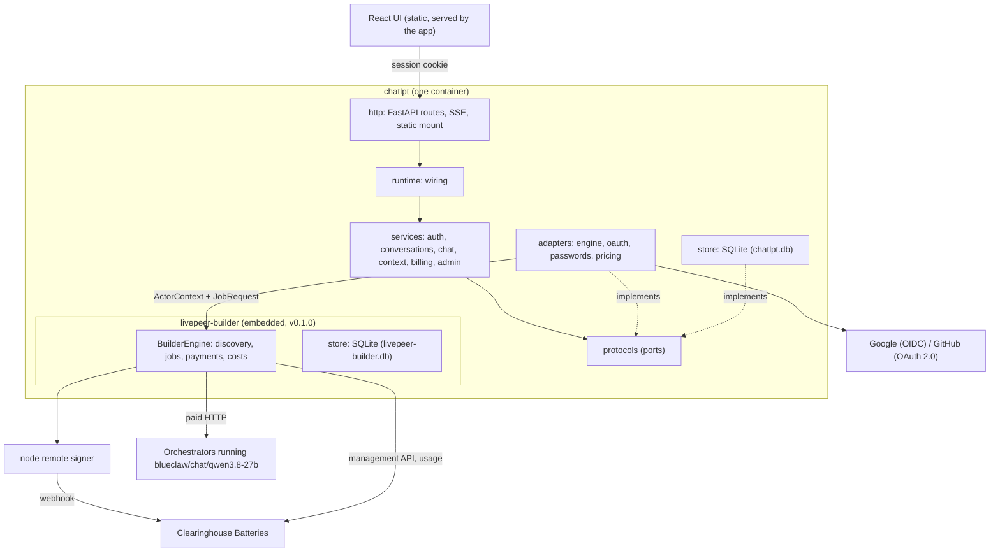

# Architecture

ChatLPT is one process. It authenticates users, keeps conversations, embeds the livepeer-builder
engine, and serves the UI. The engine answers **what the network did and what it cost**. ChatLPT
answers **who the user is, what they said, what tokens they used, and what that is worth**.

## Layers

Code depends only "forward" through these layers. `tests/structure/test_layers.py` enforces every
edge and prints how to fix a violation.

| Layer | Package | May import |
| --- | --- | --- |
| Utils | `utils.py` | nothing internal |
| Types | `contracts/` | nothing internal |
| Errors | `errors.py` | contracts |
| Providers | `protocols/` | contracts, errors |
| Config | `config.py` | contracts, errors |
| Service | `services/` | contracts, errors, protocols, config, utils |
| Repo | `store/` | contracts, errors, protocols, config, utils |
| Adapters | `adapters/` | contracts, errors, protocols, config, utils |
| Test doubles | `testing/` | contracts, errors, protocols, utils |
| App wiring | `runtime/` | everything above |
| UI | `http/` | runtime, contracts, errors, config |
| Entry points | `cli.py`, `docs_gen.py`, `__init__.py` | anything |

Services never touch a database, the engine, an identity provider or HTTP directly. They receive
protocol implementations from the runtime. That is what lets the engine adapter change from buffered
to streaming without touching a service.

## Third-party boundaries

Each third-party package is confined to one module (enforced by `tests/structure/test_layers.py`):

| Package | Only in |
| --- | --- |
| `livepeer_builder` | `adapters/engine.py`, `adapters/engine_images.py`, `adapters/discovery.py`, `runtime/engine.py` |
| `livepeer_gateway` (discovery only) | `adapters/discovery.py` |
| `authlib` | `adapters/oauth.py` |
| `httpx` | `adapters/oauth.py`, `adapters/images.py` |
| `argon2` | `adapters/passwords.py` |
| `sqlalchemy`, `alembic`, `aiosqlite` | `store/` |
| `fastapi`, `starlette`, `itsdangerous` | `http/` |

## Domains

| Domain | Service | Spec |
| --- | --- | --- |
| Identity | `services/auth.py`, `adapters/oauth.py`, `adapters/passwords.py` | [chatlpt.md#accounts](docs/product-specs/chatlpt.md#accounts) |
| Conversations | `services/conversations.py` | [chatlpt.md#chat](docs/product-specs/chatlpt.md#chat) |
| Chat (a reply) | `services/chat.py`, `adapters/engine.py` | [chatlpt.md#chat](docs/product-specs/chatlpt.md#chat), [streaming](docs/design-docs/streaming-through-the-engine.md) |
| Context window | `services/context.py` | [decisions D14](docs/design-docs/decisions.md) |
| Billing (two books) | `services/billing.py`, `adapters/pricing.py` | [chatlpt.md#usage-and-cost](docs/product-specs/chatlpt.md#usage-and-cost) |
| Images (model-driven) | `services/images.py`, `adapters/engine.py` (`EngineImages`), `adapters/images.py` | [decisions D25](docs/design-docs/decisions.md) |
| Admin | `services/admin.py` | [chatlpt.md#admin](docs/product-specs/chatlpt.md#admin) |

## The engine boundary

- The runtime builds one `BuilderEngine` from `LPB_*` settings at startup and stops it at shutdown.
- Each signed-in user maps to an `ActorContext(actor_id=<user id>, application_id="chatlpt")`
  with the permissions `discover`, `jobs.run`, `jobs.read`, `costs.read`. The engine's own
  `DefaultPolicy` still applies.
- Payment runs in `per_application` mode: one shared `lpg_` allocation key for the whole app.
  Jobs still record the actor, so wholesale cost is attributable per user.
- The engine's discovery source is ours: it reads the signer's entries, keeps runners advertising the
  chat app on the approved orchestrators, hands the engine standard `Runner` contracts, and remembers the
  runner's `metadata` (`model_id`, `max_context`) for the context window.
- Today (`v0.1.0`) a reply is `jobs.run` in immediate mode: one buffered body. The streaming design
  replaces that with `jobs.stream`; only `adapters/engine.py` changes.

## A reply, end to end

1. The route authenticates the session and loads the conversation.
2. `services/chat.py` builds the message list: system prompt, then the newest turns that fit the
   budget from `services/context.py` (the runner's `max_model_len` minus the output reserve).
3. It asks the `ChatBackend` port for a reply stream. The adapter runs the engine job with
   `stream_options.include_usage` so the final chunk carries token counts.
4. Chunks are forwarded to the browser as server-sent events **and** accumulated. If the browser
   disconnects, the service keeps consuming so the paid reply is still saved.
5. On completion the assistant message is stored with the job id, token counts, the retail cost
   computed from the price table, and wholesale cost `pending`.
6. A background task asks the engine for the job's cost until it is `delivered`, then fills the
   wholesale column. The engine is also told the token counts through `report_usage`.

When the model answers with a `generate_image` tool call instead of text, the same pipeline branches:
the assistant message becomes a `tool_call` message, `services/images.py` runs the image app through the
engine, fetches the bytes from the runner's temporary URL onto the volume and writes the image's own
ledger row, and a second model call with the tool result produces the caption as a separate message.
