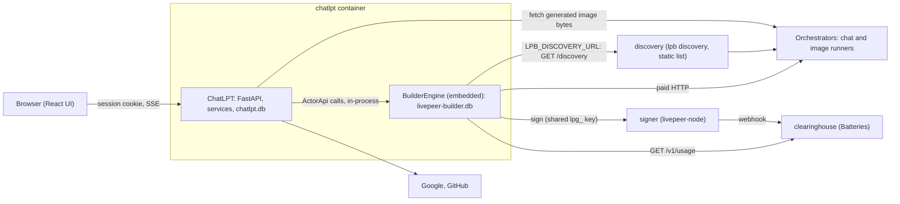
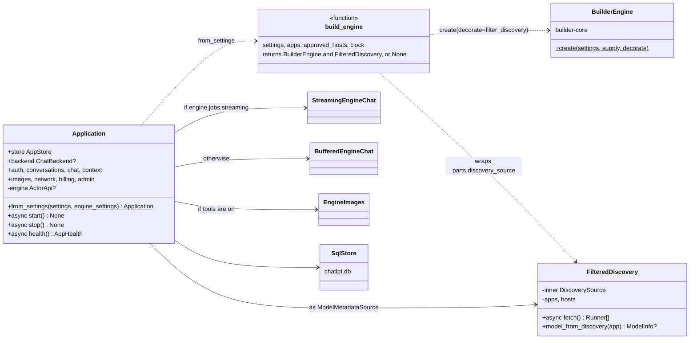
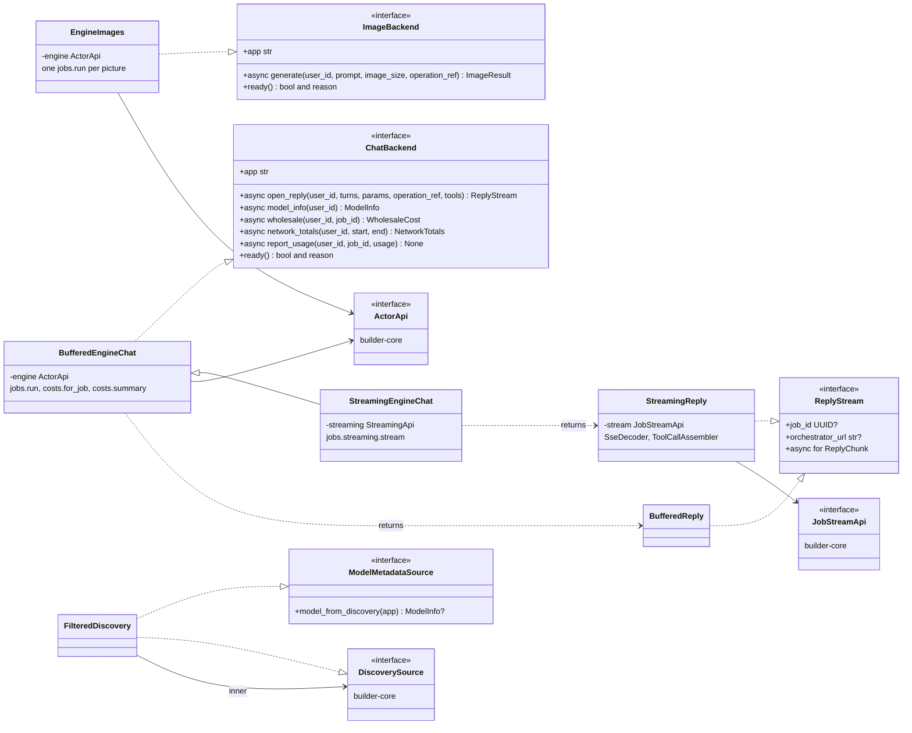
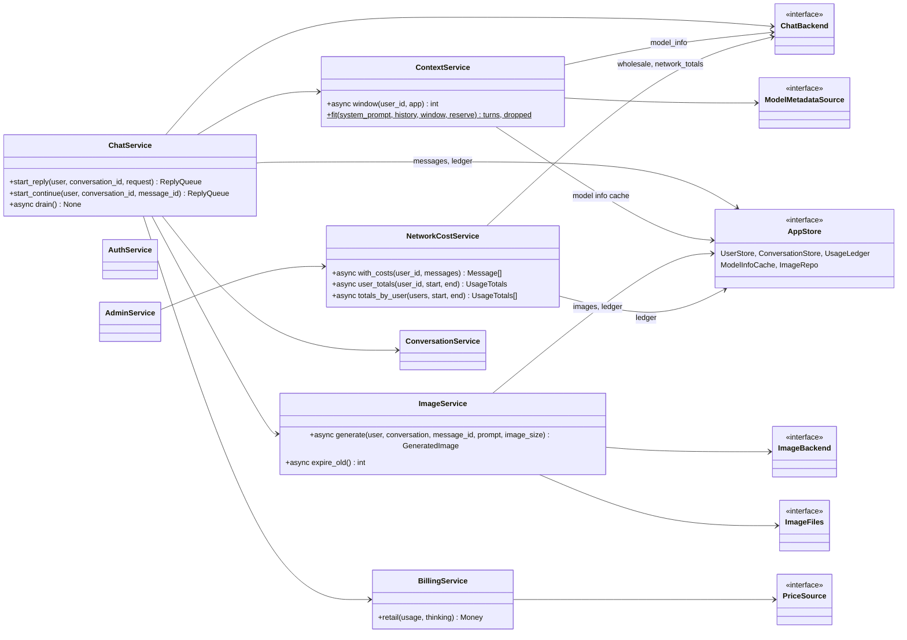
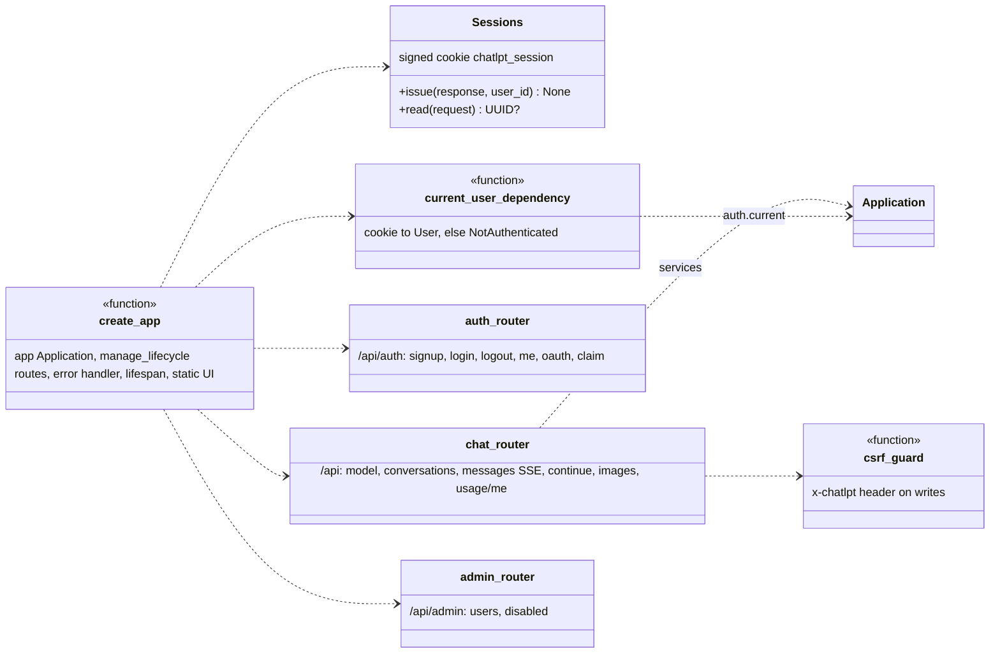
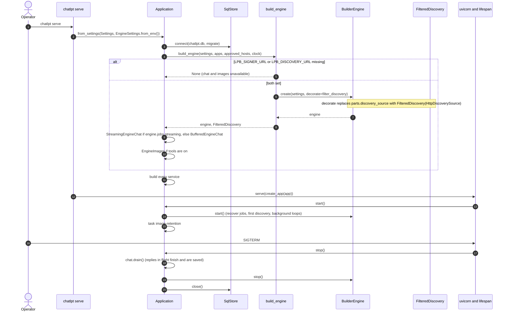
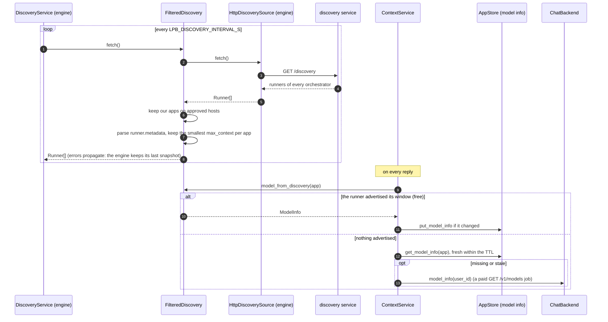
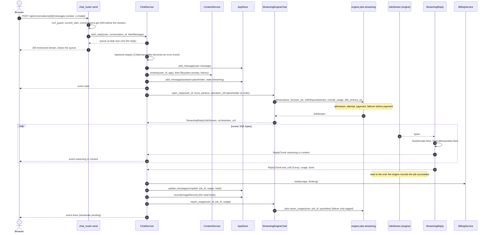
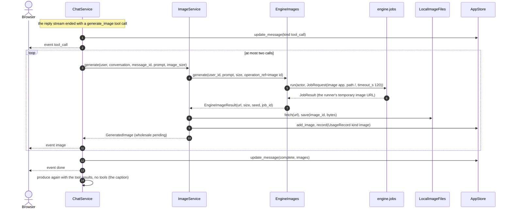
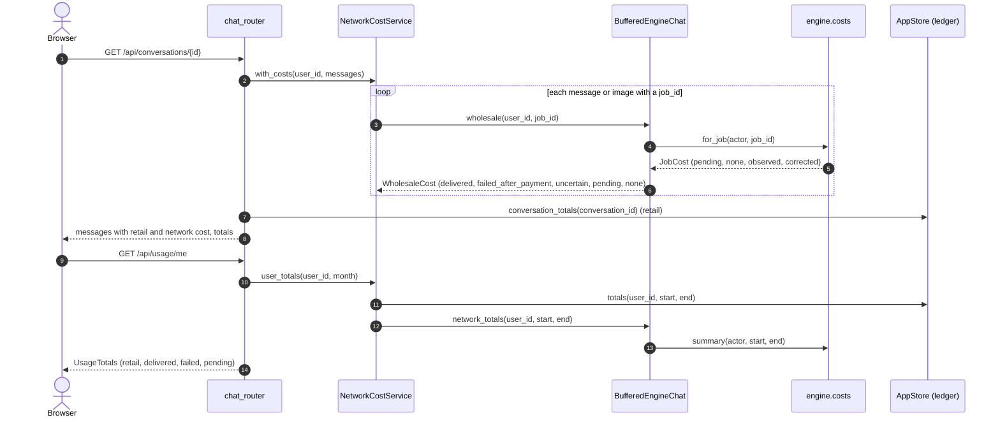

# builder-core in ChatLPT

How ChatLPT uses livepeer-builder: the classes on each side of the boundary, and the flows that cross
it. Every box and message is a real class, method, route or setting in this repository or in
builder-core, so each diagram leads to the code. The diagrams describe the code pinned to builder-core
`985f23d`, which has the discovery service (builder-core D43).

This is the consumer's view. The engine's own interfaces and its REST server are drawn in builder-core's
[interfaces-and-http-servers.md](https://github.com/NE-Build-Track/livepeer-builder-core/blob/tasks/mz/interface-walkthrough/docs/design-docs/interfaces-and-http-servers.md).
The list of calls and the behavior to design around is in [builder-engine.md](../references/builder-engine.md).

**Notation.** `<<interface>>` is a `typing.Protocol`, satisfied structurally (`..|>`). `-->` means
"holds", `..>` means "calls", `X?` is optional and `X[]` a sequence. Classes from builder-core are
marked `builder-core`.

## What runs where

ChatLPT embeds the engine in its own process (imported mode). It does not run builder-core's REST
service, and it never reaches the signer, Batteries or an orchestrator itself: the engine does.

## The part of builder-core ChatLPT uses

| builder-core | How ChatLPT uses it | Where |
| --- | --- | --- |
| `EngineSettings` | From `LPB_*`, passed to the composition root as a value | `runtime/engine.py` |
| `BuilderEngine.create(settings, decorate=...)` | Builds the engine once at startup, typed as `ActorApi` afterwards | `runtime/engine.py`, `runtime/app.py` |
| `Decorate` and `EngineParts.discovery_source` | Wraps the engine's `HttpDiscoverySource` in `FilteredDiscovery` | `runtime/engine.py`, `adapters/discovery.py` |
| `ActorContext` | One per signed-in user: `actor_id=<user id>`, `application_id="chatlpt"`, four permissions | `adapters/engine.py` (`actor_for`) |
| `jobs.streaming.stream` and `JobStreamApi` | A chat reply, streamed | `StreamingEngineChat` |
| `jobs.run` | A reply when the transport cannot stream, the model card (`GET /v1/models`) and every image | `BufferedEngineChat`, `EngineImages` |
| `jobs.report_usage` | Token counts after a reply, a courtesy copy | `BufferedEngineChat.report_usage` |
| `costs.for_job`, `costs.summary` | The network cost of a message or image, and a user's totals, read each time they are shown (D29) | `BufferedEngineChat.wholesale`, `network_totals` |
| `health()`, `discovery.candidates` | Readiness: can a reply or an image run now? | `BufferedEngineChat.ready`, `EngineImages.ready` |
| `JobFailed` and the `EngineError`s | Translated into ChatLPT's own errors at the adapter | `adapters/engine.py` (`failure_from`) |

**Not used:** `AdminApi` (provisioning, keys, grants, reconciliation), builder-core's REST service, and
engine API keys. Payment runs in `per_application` mode: one shared allocation key for the whole app,
with each job still recording the user as its actor.

## Key classes

### Composition

`Application` is ChatLPT's composition root. It builds the store, the engine and the adapters, then
every service from them, and owns their lifecycle. There is no DI container.

Without both `LPB_SIGNER_URL` and `LPB_DISCOVERY_URL`, `build_engine` returns `None`: the app still
runs, with chat and images reported unavailable in `/readyz`.

### The engine boundary

Services never see builder-core. They call ChatLPT's own ports (`ChatBackend`, `ImageBackend`,
`ModelMetadataSource`), and only the adapters import `livepeer_builder`.

`FilteredDiscovery` sits on both sides: to the engine it is a `DiscoverySource`, and to ChatLPT a
`ModelMetadataSource` that remembers each app's smallest advertised context window (D14).

### Services and their ports

### The HTTP layer

Routes call services, never the engine. The engine appears in HTTP only through `/readyz`
(`Application.health`) and the `/api/model` availability check.

## Flows

### Startup and shutdown

`stop()` runs every step even when one fails, so a stuck engine never keeps the database open.

### Discovery and the context window

### A chat reply, streamed

The route returns at once with an SSE response. The reply runs in its own task, which writes to a
queue the route drains. A browser that leaves therefore never cancels a paid reply: the task reads the
engine's stream to the end and saves the message.

Continuing a reply that hit the output limit (`/continue`, D24) is the same pipeline with the partial
answer as the final turn and `continue_final_message` set; it adds a new assistant message.

### When a reply fails

`failure_from` turns the engine's `JobFailed` into ChatLPT's errors, at the adapter. The engine's job
id stays on the message, so a paid failure still shows its network cost.

| Engine | ChatLPT | The message | The browser |
| --- | --- | --- | --- |
| `JobFailed` with `no_offering`, `no_capacity`, `not_provisioned`, `refused`, `unreachable`, `payment` | `ChatUnavailable` | `failed`, `unavailable` | `error` event with `retry_after_s` |
| `NoCapacity`, `NotProvisioned`, `ProviderUnavailable` | `ChatUnavailable` | `failed`, `unavailable` | `error` event with `retry_after_s` |
| `JobFailed` with `timeout` or `abandoned`, or job state `uncertain` | `ReplyFailed(uncertain=True)` | `uncertain`, partial text kept, `job_id` | `error` event |
| any other `JobFailed` | `ReplyFailed(payment_sent=...)` | `failed`, partial text kept, `job_id` | `error` event |
| `OperationExists`, `OperationConflict` | `Conflict` | left `streaming` (see question 6) | `error` event |
| any other `EngineError` | `ReplyFailed(payment_sent=False)` | `failed` | `error` event |

Once the SSE response has started, every error reaches the browser as an `error` event, not as an HTTP
status. Errors before it (`401`, `404`, a missing `x-chatlpt` header) are ordinary statuses from the
`AppError` handler.

### A reply that draws an image

When the model answers with a `generate_image` tool call, the reply becomes a `tool_call` message, the
image runs as a separate buffered job, and a second model call captions it (D25).

### Showing what a reply cost

ChatLPT keeps two books (D29). The retail book (what the user is charged) lives in ChatLPT's ledger.
The network book (what Livepeer charged) stays in the engine and is read each time it is shown. They
join on the job id.

A cost the engine cannot answer is shown as `unknown`, never as $0.

## Questions for the review

Points worth deciding, noticed while drawing these:

1. **Readiness reads `discovery.candidates`.** `BufferedEngineChat.ready` and `EngineImages.ready`
   call it, and it checks no permission (builder-core review question 1). If builder-core moves it,
   ChatLPT needs another way to ask "can this app run now?".
2. **The same error translation appears three times.** `BufferedEngineChat._run`,
   `StreamingEngineChat.open_reply` and `EngineImages.generate` repeat the same `except` clauses.
3. **A reply is read to the runner's end.** `StreamingReply` never calls `JobStream.complete()`, so a
   runner that sends `data: [DONE]` and then holds the connection keeps the job open until
   `idle_timeout_s`.
4. **The model card is a paid job.** `GET /v1/models` runs through `jobs.run` whenever discovery
   metadata is missing and the cached window is stale (D14).
5. **Per-user cost relies on `actor_id` alone.** In `per_application` mode every user shares one
   allocation, so the engine's per-user totals depend on the job's actor, not on separate allocations.
6. **A reply can stay `streaming`.** `ChatService._produce` updates the placeholder only on
   `ReplyFailed` and `ChatUnavailable`. A `Conflict`, an unexpected error, or a restart mid-reply leaves
   the message `streaming`, and nothing resolves it on start, unlike the engine's
   `recover_interrupted`. The engine's job record is still correct.
