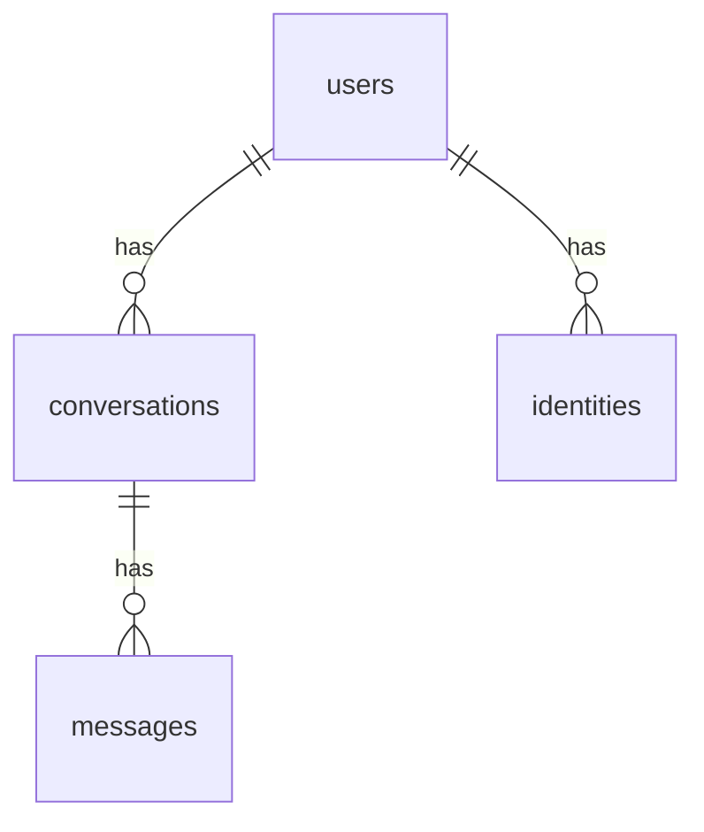

# Database schema

Generated by `chatlpt gen-docs` from `chatlpt.store.schema`. Do not edit.

## Entity relationship diagram

## `model_info`

| Column | Type | Nullable | Notes |
| --- | --- | --- | --- |
| `app` | VARCHAR(200) | no | primary key |
| `model_id` | VARCHAR(200) | no |  |
| `max_model_len` | INTEGER | no |  |
| `observed_at` | DATETIME | no |  |

## `usage_records`

| Column | Type | Nullable | Notes |
| --- | --- | --- | --- |
| `message_id` | VARCHAR(36) | no | primary key |
| `user_id` | VARCHAR(36) | no |  |
| `conversation_id` | VARCHAR(36) | no |  |
| `job_id` | VARCHAR(36) | yes |  |
| `prompt_tokens` | INTEGER | no |  |
| `completion_tokens` | INTEGER | no |  |
| `reasoning_tokens` | INTEGER | no |  |
| `cached_prompt_tokens` | INTEGER | no |  |
| `retail_usd` | VARCHAR(64) | no |  |
| `wholesale_status` | VARCHAR(24) | no |  |
| `wholesale_usd` | VARCHAR(64) | yes |  |
| `wholesale_orchestrator_url` | VARCHAR(255) | yes |  |
| `wholesale_updated_at` | DATETIME | yes |  |
| `created_at` | DATETIME | no |  |

## `users`

| Column | Type | Nullable | Notes |
| --- | --- | --- | --- |
| `id` | VARCHAR(36) | no | primary key |
| `email` | VARCHAR(320) | no |  |
| `display_name` | VARCHAR(120) | no |  |
| `password_hash` | VARCHAR(255) | yes |  |
| `is_admin` | BOOLEAN | no |  |
| `disabled` | BOOLEAN | no |  |
| `created_at` | DATETIME | no |  |

## `conversations`

| Column | Type | Nullable | Notes |
| --- | --- | --- | --- |
| `id` | VARCHAR(36) | no | primary key |
| `user_id` | VARCHAR(36) | no | → users.id |
| `title` | VARCHAR(200) | no |  |
| `thinking` | VARCHAR(8) | no |  |
| `created_at` | DATETIME | no |  |
| `updated_at` | DATETIME | no |  |

## `identities`

| Column | Type | Nullable | Notes |
| --- | --- | --- | --- |
| `provider` | VARCHAR(16) | no | primary key |
| `subject` | VARCHAR(255) | no | primary key |
| `user_id` | VARCHAR(36) | no | → users.id |
| `email` | VARCHAR(320) | no |  |
| `created_at` | DATETIME | no |  |

## `messages`

| Column | Type | Nullable | Notes |
| --- | --- | --- | --- |
| `id` | VARCHAR(36) | no | primary key |
| `conversation_id` | VARCHAR(36) | no | → conversations.id |
| `role` | VARCHAR(16) | no |  |
| `content` | TEXT | no |  |
| `reasoning` | TEXT | yes |  |
| `state` | VARCHAR(16) | no |  |
| `job_id` | VARCHAR(36) | yes |  |
| `orchestrator_url` | VARCHAR(255) | yes |  |
| `prompt_tokens` | INTEGER | yes |  |
| `completion_tokens` | INTEGER | yes |  |
| `reasoning_tokens` | INTEGER | yes |  |
| `cached_prompt_tokens` | INTEGER | yes |  |
| `retail_usd` | VARCHAR(64) | yes |  |
| `wholesale_status` | VARCHAR(24) | yes |  |
| `wholesale_usd` | VARCHAR(64) | yes |  |
| `wholesale_updated_at` | DATETIME | yes |  |
| `finish_reason` | VARCHAR(32) | yes |  |
| `continues_message_id` | VARCHAR(36) | yes |  |
| `dropped_turns` | INTEGER | yes |  |
| `error` | TEXT | yes |  |
| `created_at` | DATETIME | no |  |
