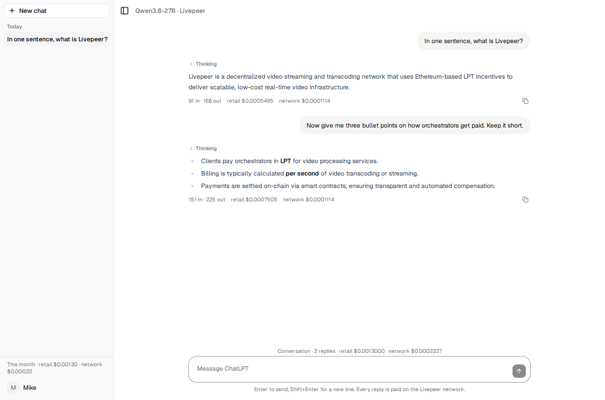
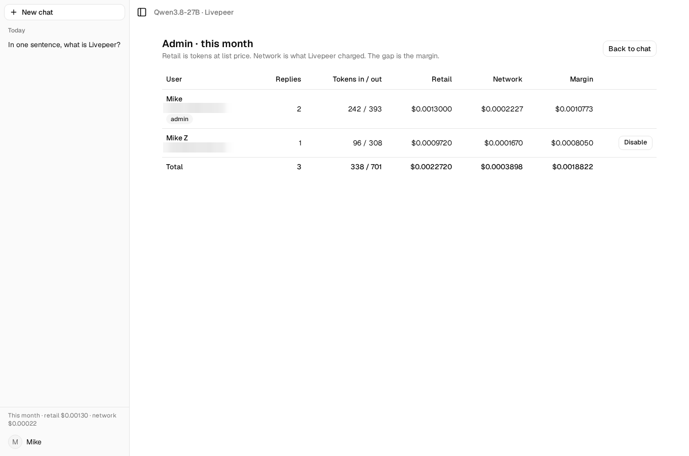

# Runtime evidence: the payment stack and the first paid replies, 19 October 2026

Plan [02](../../exec-plans/completed/plan-02-payments-stack.md). Everything ran from `deploy/compose.yaml`
on the developer's machine: Clearinghouse Batteries `ca09e47`, node signer `406b248` (v1.0.2), and
ChatLPT at commit `12f35e4` plus the fixes recorded below, embedding livepeer-builder `v0.1.0`.

| Component | Identity |
| --- | --- |
| Payer | keystore `0x5ae4e42d…3d0b` (`~/.livepeer/keys/cloud-spe-gateway`), Arbitrum One RPC `arbitrum.liveinfraspe.com` |
| Grant / allocation | `AaFWEXteeuCF5BRhhChWNg` / `AaFWEnucfhuOCn95t02zMw`, $2.00 USD, `per_application` (D3) |
| Orchestrators discovered | xode us-central, speedybird, hky.eliteencoder: 3 runners advertising `blueclaw/chat/qwen3.8-27b`, capacity 8 each, 4634466808 wei/s. open-pool advertised no chat runner at the time |
| Runner metadata | `{"blueclaw":1,"capability":"openai:chat-completions","unit":"tokens","model_id":"Qwen3.8-27B","name":"Qwen 3.8 27B","category":"chat","max_context":131072}` |

## What happened

1. **Secrets and stack.** `deploy/init-secrets.py`, the keystore and RPC URL copied in, certificates
   pinned for all four hosts, `docker compose up -d clearinghouse signer`. The signer answered
   `readyz` within seconds and discovered 17 runners on 4 orchestrators.
2. **Shared allocation.** `grant create` returned `{"id": …}`; `api-key create --grant-id` returned
   `allocation_id`, key `id` and the `lpg_` secret, written to `deploy/.env` as `LPB_SHARED_*`.
   (The grant step was run by hand to learn the CLI's output; `deploy/first-run.sh` encodes the same
   sequence and refuses to run twice, T5.)
3. **ChatLPT up.** `/readyz`: database ok, chat available, engine configured. The model id and the
   context window came from the runner's discovery metadata, no paid call (D14).
4. **Paid replies through the engine**, all served by xode's orchestrator in one attempt each:

   | Job | Who | Prompt | In / out tokens | Retail (list price) | Wholesale (engine) | Wall time |
   | --- | --- | --- | --- | --- | --- | --- |
   | `1c82616e` | app | `GET /v1/models` probe (before the metadata path existed) | – | – | $0.000111361 | 0.9 s |
   | `a3bd09e9` | admin | "In one sentence, what is Livepeer?" | 91 / 168 | $0.0005495 | $0.000111361 (1 usage row) | 4.0 s |
   | `9b31a9fb` | a second account, through the browser | – | 96 / 308 | $0.0009720 | $0.000167041 (2 usage rows) | 5.7 s |
   | `48689555` | admin | "three bullet points on how orchestrators get paid" | 151 / 225 | $0.0007505 | $0.000111361 first observation | 4.4 s |

   Replies included reasoning text (699 characters on the second one) with `reasoning_tokens: 0`,
   so vLLM did not report `completion_tokens_details` here; reasoning is inside `completion_tokens`.
5. **Attribution.** Every attempt logged one manifest; every manifest matched one Batteries
   payment session (`lpb_payment_sessions.match_status = matched`). Batteries `allocation_spent` was
   **$0.000501124** when read, equal to the four jobs' rows: 4 × $0.000111361 + $0.000055680.
   The admin page showed retail $0.002272 against network $0.000390 for the month at that moment.
6. **Two defects found and fixed on the spot.**
   - The engine reports cost status `none` for about 16 s after a job ends. The first sync recorded
     that as final; it now treats `none` as "not yet known" and keeps polling, and it re-reads filled
     costs for `CHATLPT_WHOLESALE_SETTLE_MINUTES` (10) because a cost grows as more usage rows arrive
     (the third job went from one row to two).
   - The chat page crashed on first render in the browser: shadcn's `Tooltip` needs a
     `TooltipProvider`. The second account hit this after their reply completed. Fixed in `main.tsx`.

## Screenshots

## Not covered

- open-pool (no chat runner advertised) and hky, speedybird (the engine chose xode every time).
- Failover before payment, a refused payment, a timeout after payment.
- Provider sign-in against real Google or GitHub applications (plan-03).
