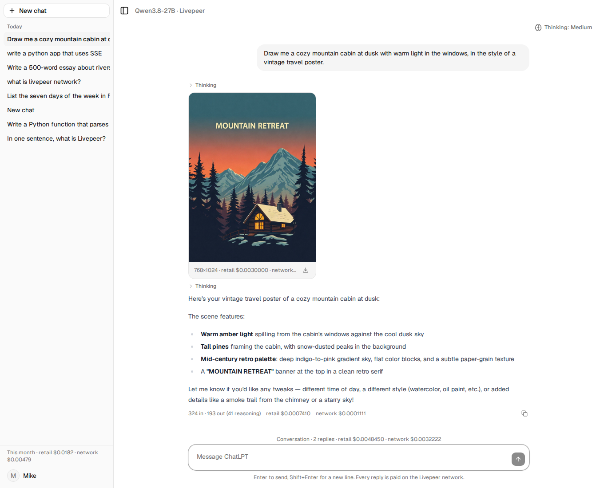

# Runtime evidence: model-driven image generation, 19 October 2026

The check behind D25: can the Qwen runner decide to draw through tool calling, can the engine run the
FLUX app, and can the model caption the result? Run from a script against the ChatLPT payment stack
with the engine from branch `tasks/m3/mz/stream-support` at `973ac57`.

## Where the apps are

| App | Orchestrators advertising it (approved list) |
| --- | --- |
| `blueclaw/chat/qwen3.8-27b` | xode us-central, speedybird, hky.eliteencoder |
| `comfystream/fal-flux-schnell` | **none of the original four.** Of every orchestrator on the Railway signer's list, only `https://ai1.eliteencoder.net:8936` advertises it (77 runners, 73 fal apps). Mike approved adding it (D8). |

## The loop

| Step | Result |
| --- | --- |
| 1. Chat with `tools=[generate_image]`, `tool_choice: auto`, "Draw me a watercolor lighthouse at sunset." | `finish_reason: tool_calls`; a parsed call with a 60-word prompt the model wrote and `image_size: portrait_4_3`; 2.3 s, 392/123 tokens. In an earlier run with thinking **off** the model answered in prose and made no call; with thinking **on** it called every time. The decision is sampled, so the app should offer tools with at least low thinking. |
| 2. Control: "What is a lighthouse for? One sentence." | A plain answer, no tool call, 1.2 s. |
| 3. `comfystream/fal-flux-schnell` with the model's prompt | 4.7 s on ai1.eliteencoder.net; one 768×1024 JPEG, seed 435584106, safety flag false, inference 1.04 s; the `fal.media` URL served 678 KB. |
| 4. Tool result back (`role: tool` with size and seed) | A two-paragraph caption, `finish_reason: stop`, 569/67 tokens, 1.5 s. |
| 5. Costs | three chat jobs at $0.000111 each; the image job **$0.003007** (fixed); all observed and matched. |

## What this fixes in the design

- Tool calling works on this runner without any change to the chat template or the engine; the
  engine already carries `tools` in the payload untouched.
- Model-driven images are three paid jobs per picture: the decision, the image, the caption. Each
  keeps its own ledger row.
- Retail for an image comes from fal's list price per megapixel ([fal-pricing](../fal-pricing.md));
  it is nearly equal to the network price for this app.

## Addendum: through the deployed app

With plan 07 deployed (schema `0004`, `ai1.eliteencoder.net` approved), one request through
`POST /api/conversations/{id}/messages`: "Draw me a cozy mountain cabin at dusk with warm light in the
windows, in the style of a vintage travel poster."

| Step | What the app did |
| --- | --- |
| The model's decision | a `tool_call` event with a 130-word prompt it wrote itself and `image_size: portrait_4_3`; 426 prompt / 297 completion tokens, 94 of them reasoning |
| The image | `comfystream/fal-flux-schnell` on ai1.eliteencoder.net: 768×1024 JPEG, 704 KB, written to `/data/images/37d2e405….jpg`, served back by `GET /api/images/{id}` to the owner only |
| The caption | a second model call with the tool result: 324 / 193 tokens, Markdown describing the scene |
| Events seen by the browser | 2 `start`, 74 `reasoning`, 1 `tool_call`, 1 `image`, 83 `content`, 2 `done` |
| Ledger | three rows: chat $0.001104 retail / $0.000111 network, image **$0.003 retail / $0.003000 network**, chat $0.000741 / $0.000111. All three `delivered` within a minute |
| Conversation totals | retail $0.004845, network $0.003222, nothing pending |

