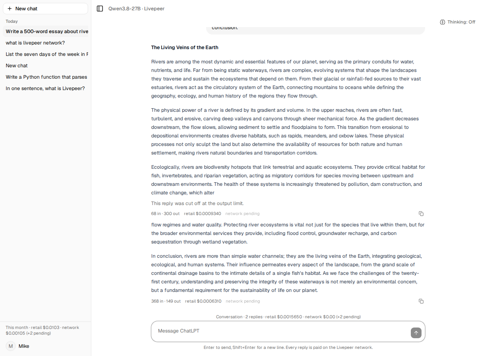

# Runtime evidence: streamed replies through the deployed app, 19 October 2026

Plan [06](../../exec-plans/completed/plan-06-streaming-adapter.md). The deployed ChatLPT (commit after
`5771221`, image rebuilt) runs the engine from builder-core branch `tasks/m3/mz/stream-support` at
`973ac57` (vendored as a wheel at the time; now a git pin). Same payment stack as the [first paid replies](2026-10-19-first-paid-replies.md).

## One reply, timed from the browser's point of view

`POST /api/conversations/{id}/messages` with "List the seven days of the week in French, one per
line, then say done." The server-sent events were timestamped as they arrived:

| Event | When |
| --- | --- |
| `start` (job accepted, placeholder stored) | 12 ms |
| first `reasoning` delta ("We") | 1,375 ms |
| reasoning deltas | 62, arriving every 8 to 30 ms |
| `content` deltas | 12 |
| `done` | 2,557 ms |

Final message: state `complete`, `finish_reason` `stop`, 100 prompt tokens, 137 completion tokens of
which 112 reasoning (the stream's usage event now carries `completion_tokens_details`), retail
$0.000461, served by speedybird's orchestrator. Wholesale was `pending` at `done` and arrived
through the settle loop afterwards (status `delivered`, $0.000111275238035945).

Under the buffered adapter the same request showed nothing until about 4 s and then everything at
once; with streaming the first token is on screen at 1.4 s and the answer builds over the next
1.2 s. The UI, services and stores did not change: only `adapters/engine.py` and the dependency pin
(D20).

## What else the streamed path proved

- The engine's `jobs.stream` is used when present (`hasattr(engine.jobs, "stream")`); the buffered
  adapter remains for an engine without it.
- `stream_options.include_usage` works on this runner: the last event carries token counts with
  reasoning detail, so the retail book is exact for streamed replies too.
- A reply that fails after it started keeps the text that arrived (unit-tested with the scripted
  backend; not provoked live).

## Not covered

- A client disconnect mid-reply on the real network (the service keeps reading by design; unit-tested).
- The engine's own live streaming evidence is in builder-core:
  `docs/references/evidence/2026-10-19-streaming-live.md` on the branch.

## Addendum, later the same day: continue generating and thinking levels (D24)

To prove vLLM's `continue_final_message` on this runner, the output cap was set to 300 tokens for
one deployment, thinking switched off on a fresh conversation through `PATCH /api/conversations/{id}`,
and a 500-word essay requested.

| Step | Result |
| --- | --- |
| First reply | `finish_reason: length`, 68 prompt / 300 completion tokens, ends mid-sentence: "…dam construction, and climate change, which alter" |
| `POST …/messages/{id}/continue` | a new segment with `continues_message_id` set; 368 prompt tokens (history plus the partial answer), 149 completion tokens, 93 content deltas, `finish_reason: stop` |
| The continuation's first words | " flow regimes and water quality. Protecting river ecosystems is vital…": the sentence completes where the first segment stopped |
| Conversation totals | 2 replies, 449 completion tokens; each segment is its own paid job and ledger row |

The cap went back to 32,768 afterwards. Spend for the two segments: about $0.0002.

